# Pulsed Radar Signal Processing in MATLAB

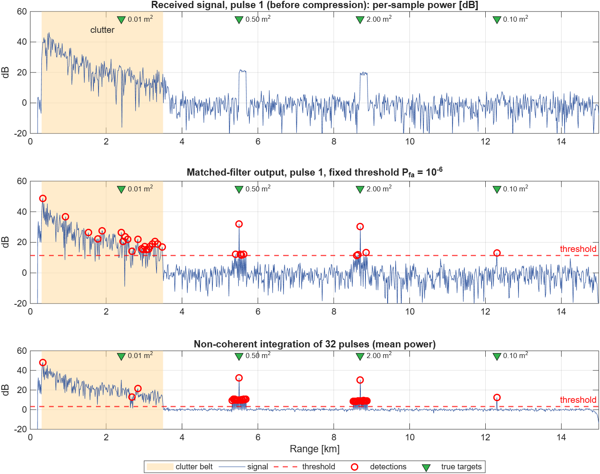

This is a pulsed-radar processing chain built from first principles in plain MATLAB (no
toolboxes). It covers the pulse train and range ambiguity, the receiver noise figure and radar
equation, detection theory, Barker pulse compression with Doppler, radar cross section and
Swerling fluctuation, CFAR detection and MTI clutter cancellation. All of it comes together
in a simulated scene with targets, clutter and noise. Every model is checked against its closed
form, and the checks run as an automated test suite.

It started as the *Radiolocalización* lab sessions at UPC-EETAC and was extended in 2026,
in the areas marked **[2026]**.


## Results

### End-to-end demo [2026]
`scripts/demo_end_to_end.m` simulates an S-band radar: Barker-13 pulse (15 m compressed
resolution), PRI 100 µs (15 km unambiguous range) and 32 pulses per CPI. The receiver noise
figure comes from the Lab 2 chain. The scene has four targets, whose SNR is computed with the
radar equation, plus a Rayleigh ground-clutter belt between 0.3 and 3.5 km. The clutter has a
Gaussian Doppler spectrum with an rms internal-motion velocity of 1 m/s, an illustrative
strong-wind value that gives the MTI something to work against.

| Target | Range | RCS | SNR/sample | After compression | Fixed, 1 pulse | Fixed, NCI-32 | CA-CFAR, 1 pulse | CA-CFAR, NCI-32 |
|---|---|---|---|---|---|---|---|---|
| 1 drone | 2.4 km | 0.01 m² | 18.6 dB | 29.7 dB | masked | masked | missed | detected* |
| 2 | 5.5 km | 0.5 m² | 21.2 dB | 32.3 dB | detected | detected | detected | detected |
| 3 | 8.7 km | 2 m² | 19.2 dB | 30.4 dB | detected | detected | detected | detected |
| 4 | 12.3 km | 0.1 m² | 0.2 dB | 11.3 dB | detected (Pd ≈ 0.5) | detected | detected (Pd ≈ 0.5) | detected |

| False alarms (sidelobe / clutter / noise) | 1 pulse | 32-pulse NCI |
|---|---|---|
| Fixed threshold | 7 / 20 / 0 | 24 / 3 / 0 |
| CA-CFAR (M = 32, G = 3) | 0 / 1 / 0 | 4 / 15 / 0 |

\* Detected, but in the same clutter belt that produces 15 false alarms, so an operator could
not trust it.

What the demo shows:
- **Pulse compression adds 11.1 dB.** Target 4 is invisible in the raw echo. After compression,
  a single pulse detects it with Pd ≈ 0.5 (it happens to be detected in this realisation), and
  integrating 32 pulses makes detection certain.
- **A fixed threshold fails inside clutter.** The threshold fires on the clutter itself, and the
  drone cannot be separated from it.
- **Integration has a side effect.** Integrating 32 pulses lowers the threshold to about 3 dB
  above the noise. The −22 dB Barker range sidelobes of targets 2 and 3 stay above that, so they
  are reported as false targets.

- **[Lab 6] CA-CFAR fixes the single-pulse case.** Estimating the noise locally removes 19 of
  the 20 clutter false alarms and all 7 sidelobe ones, without losing any target outside the
  clutter. The one that
  remains sits on the clutter edge, which is the CA-CFAR failure mode quantified in the Lab 6
  section.
- **[Lab 6] But CFAR after integration breaks down in clutter.** The clutter barely changes over
  the 3.2 ms CPI, so an integrated clutter cell is not the Gamma(32) variable that α was
  calibrated for, and clutter false alarms rise from 3 to 15.

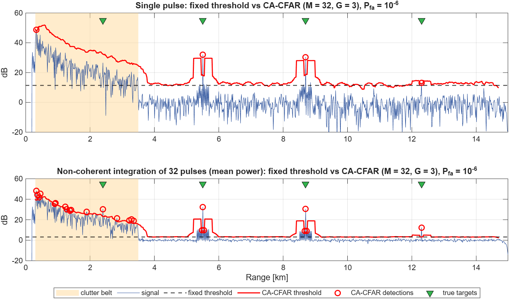

**[Lab 7] MTI before integration** (32-pulse NCI with CA-CFAR):

| Slow-time stage | Drone (15 m/s) | Targets 2–4 | False alarms (sidelobe / clutter / noise) |
|---|---|---|---|
| None | detected* | detected | 4 / 15 / 0 |
| Single canceller | **detected** | detected | 2 / 2 / 0 |
| Double canceller | **lost** (−41 dB notch) | detected | 1 / 0 / 0 |

The single canceller removes most of the clutter. That restores the CFAR behaviour after
integration, and the drone, which sits 20 dB down in the canceller notch, survives. The double
canceller removes the residual clutter completely, but its notch also wipes out the slow drone.
This is the classic MTI trade-off between clutter rejection and slow-target visibility.

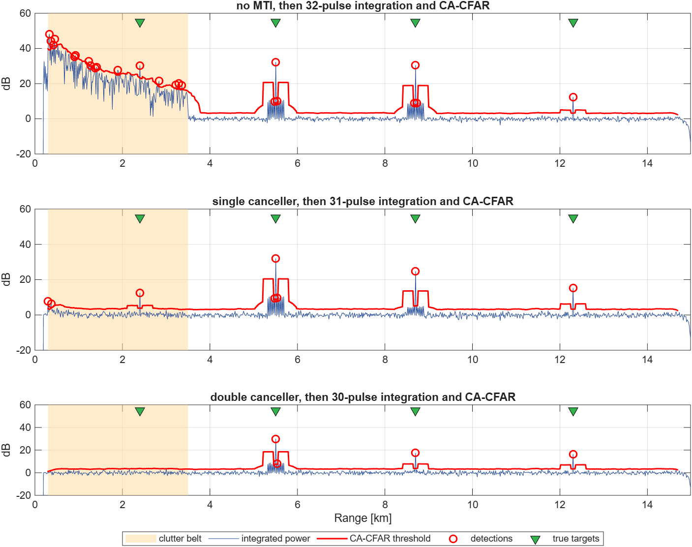

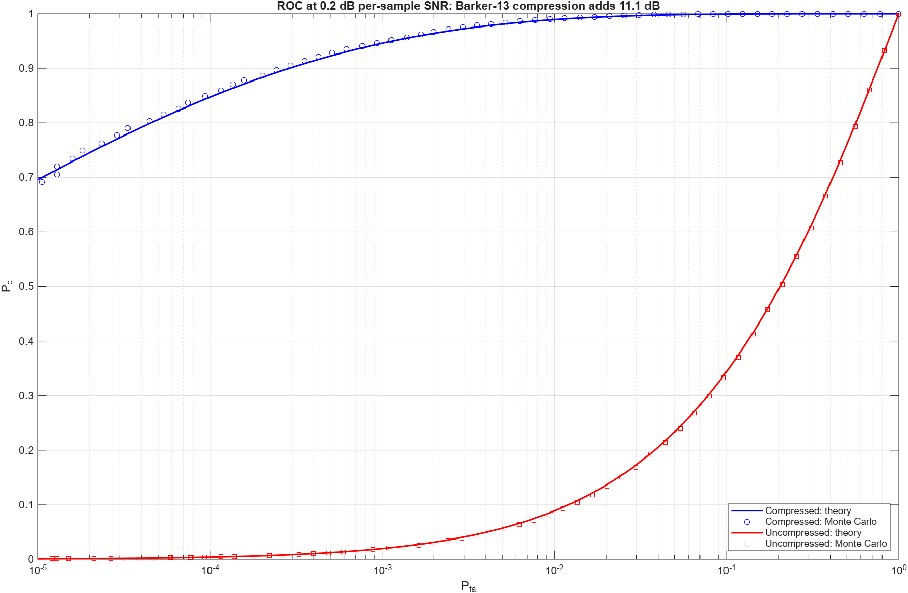 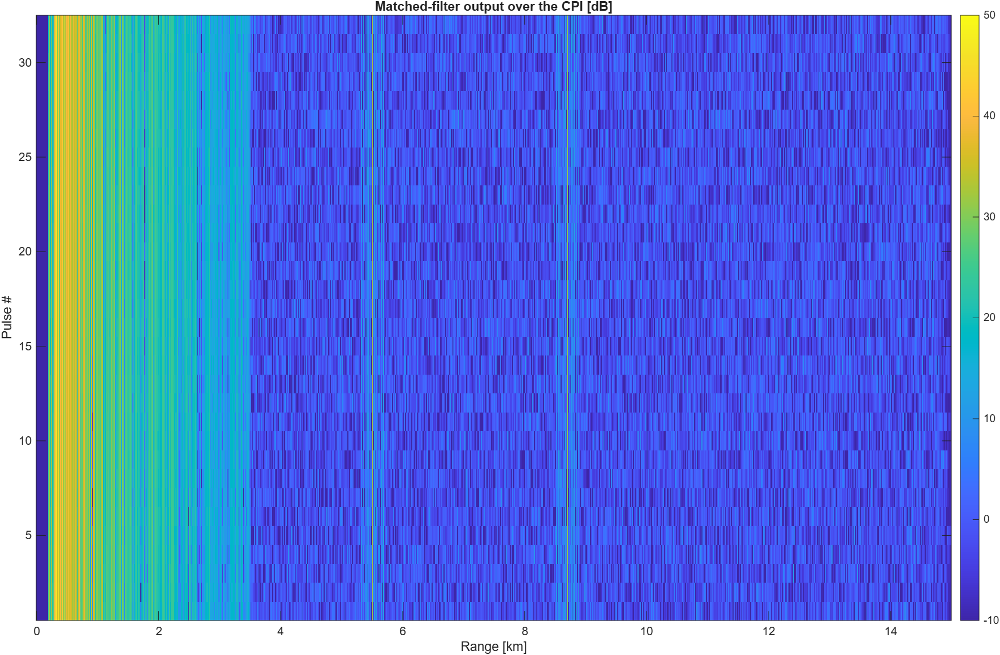

*Left: Monte Carlo ROC through the real matched-filter chain, against the exact Marcum-Q theory
(maximum difference in Pd 0.007 for Pfa > 10⁻⁴). Right: matched-filter output over the CPI.*

### Pulse train and range ambiguity (Lab 1)
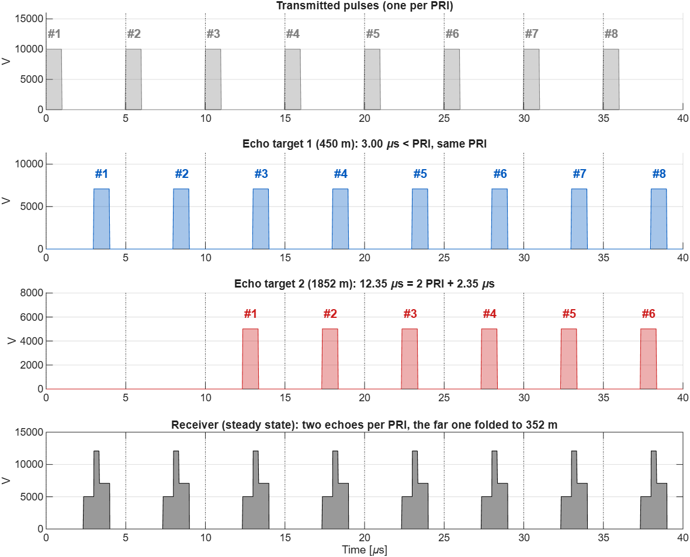 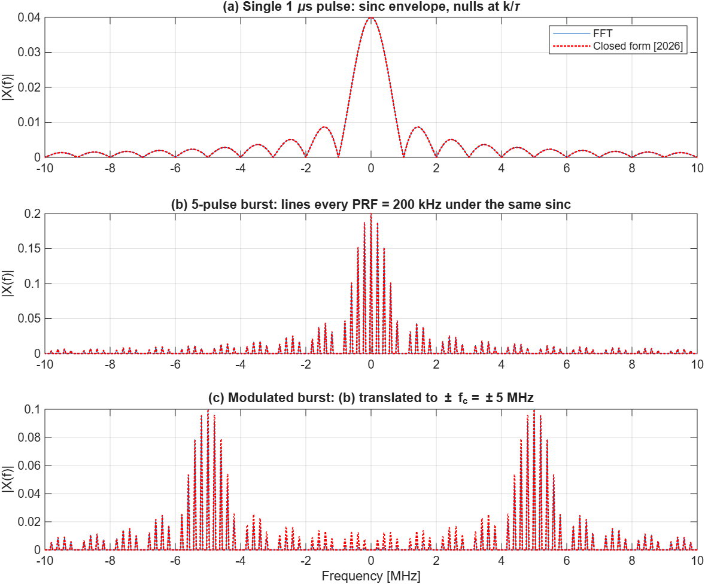

With τ = 1 µs and PRI = 5 µs, the blind range is 150 m and the unambiguous range is 750 m. A
target at 1 NM (1852 m) echoes after 12.35 µs, two PRIs late, and shows up as a ghost at 352 m.
The FFT spectra (sinc envelope, lines every PRF, copies at ±f_c) match the closed-form DFT to
**2·10⁻¹⁵**. This check exposed a floating-point bug in the original lab code, where some pulses
had 101 samples instead of 100. The bug is now fixed and covered by a regression test.

### Receiver chain and radar equation (Lab 2)
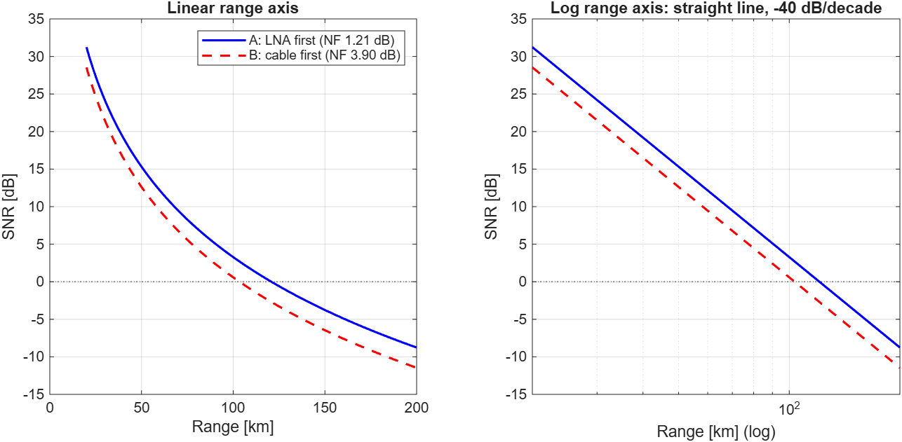

- **Noise figure (Friis).** Mounting the LNA first gives NF = 1.21 dB. Putting 2.7 dB of cable in
  front of it gives 3.90 dB: the loss adds almost one-to-one, and costs 14 % of detection range.
- **Range dependence.** SNR falls as R⁻⁴, a straight line of −40 dB/decade.

### Detection theory (Lab 3)
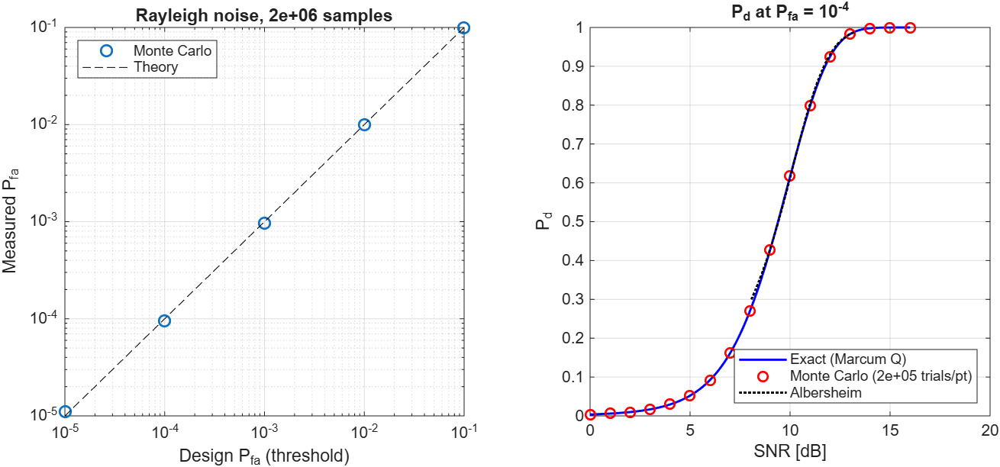 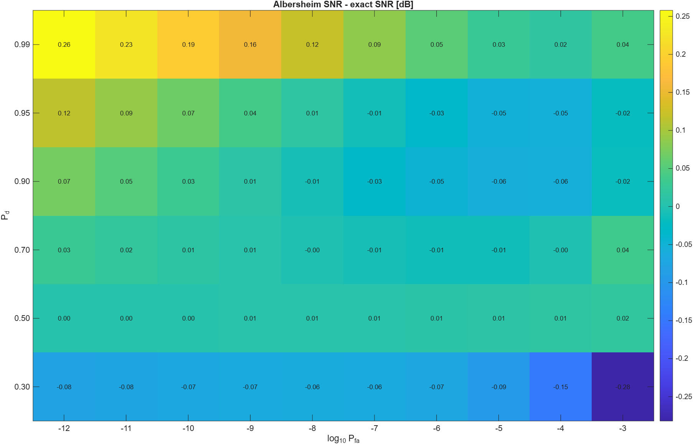

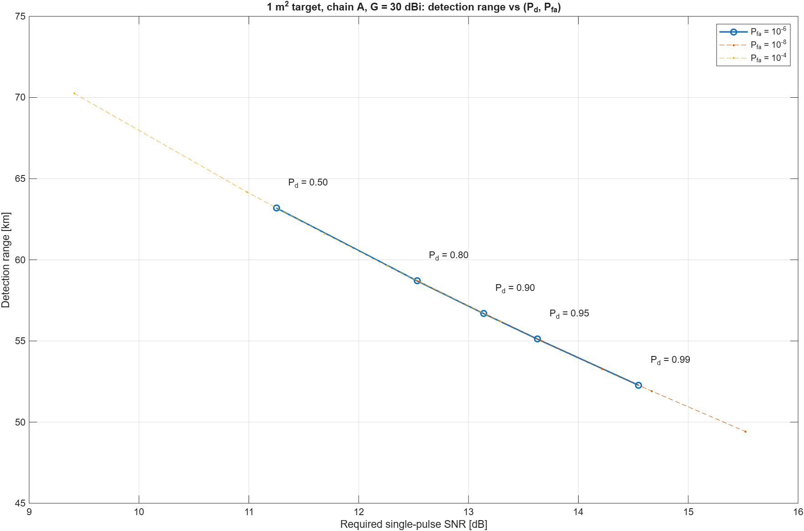

- **Time between false alarms.** Tfa = e^(V_T²/2ψ₀)/BW: raising the threshold from 12 to 14 dB
  means 10⁴ times fewer false alarms.
- **[2026] Albersheim vs exact.** The Marcum Q function is implemented from scratch with
  `besseli` and `integral`. Albersheim's empirical SNR stays within **0.28 dB** of the exact
  result over Pd 0.3–0.99 and Pfa 10⁻¹²–10⁻³.
- **[2026] Monte Carlo.** Simulated Pfa (2·10⁶ samples) and Pd (2·10⁵ trials per point) agree
  with theory within their binomial uncertainty.
- **[2026] Detection range.** The Lab 2 radar equation is combined with Albersheim's equation.
  A 1 m² target is detected with Pd = 0.9 and Pfa = 10⁻⁶ out to 56.7 km with the LNA-first
  chain and 48.5 km with the cable-first chain. The antenna gain of 30 dBi is assumed, because
  the lab figure does not give it.

### Pulse compression and Doppler (Lab 4)
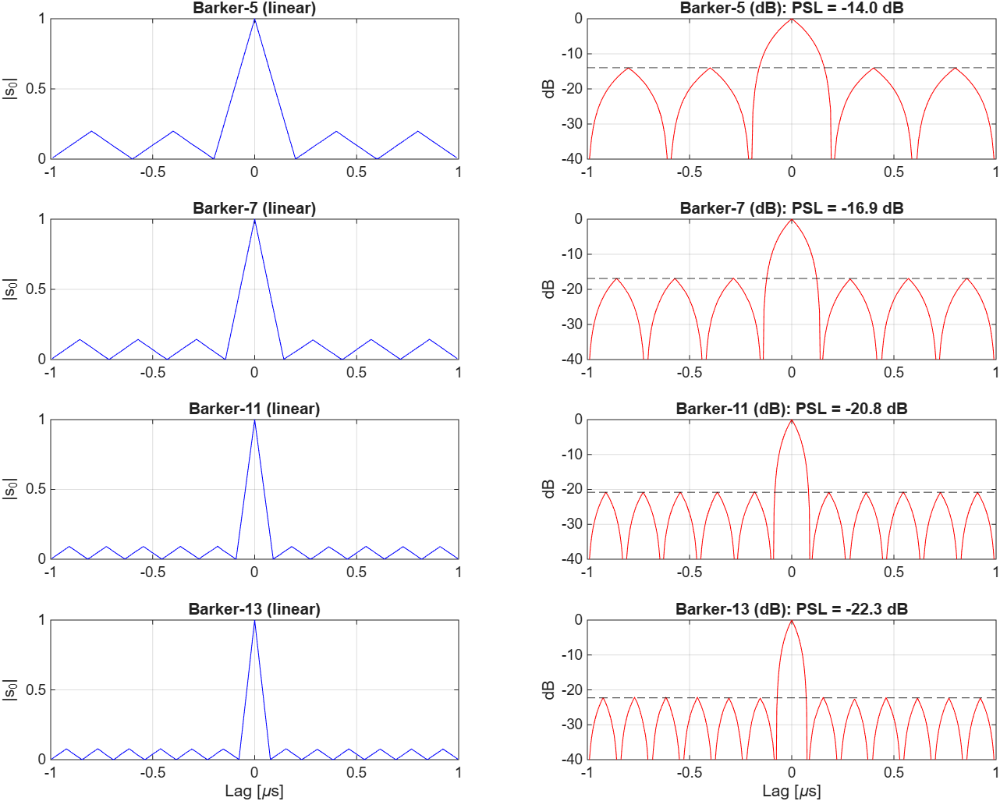 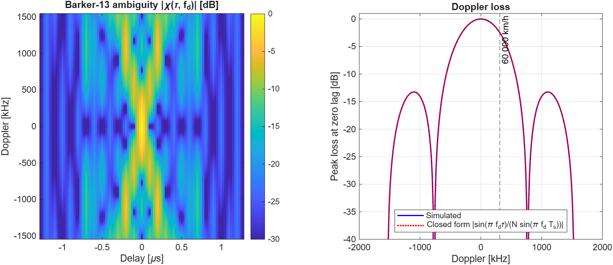

| Barker code | PSL measured | 20·log₁₀(1/K) | Lobes | Main lobe |
|---|---|---|---|---|
| B-5 | −13.98 dB | −13.98 dB | 5 | 0.40 µs |
| B-7 | −16.90 dB | −16.90 dB | 7 | 0.29 µs |
| B-11 | −20.83 dB | −20.83 dB | 11 | 0.18 µs |
| B-13 | −22.28 dB | −22.28 dB | 13 | 0.15 µs |

- **Compression gain.** Measured gain is 24.22 dB, against 10·log₁₀(260) = 24.15 dB in theory.
- **Doppler.** At 60 000 km/h (311 kHz), Barker-13 loses 2.5 dB of peak. The simulated Doppler
  loss matches the closed form to 3·10⁻¹⁴ dB.
- **Code mismatch.** B-11 contains the inverted B-5, so a B-5 filter fed with B-11 gives a
  full-height false peak. The envelope detector cannot tell a match from an inverted match.
- **No Barker code of length 6.** An exhaustive search confirms it, with positive controls that
  find the known codes for K = 5, 7 and 13.

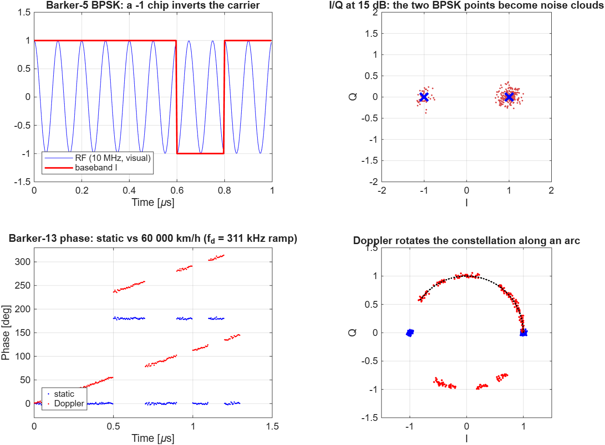

### Radar cross section and Swerling models (Lab 5)
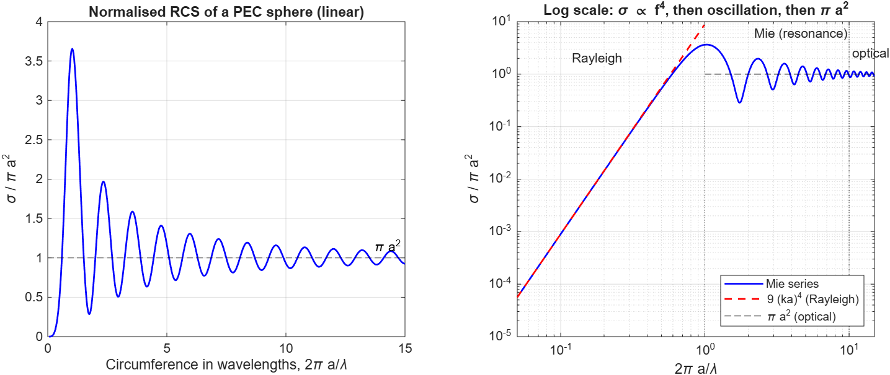

- **5.1 Sphere.** The exact Mie series, implemented from scratch, shows the three regions. In the
  Rayleigh region σ follows 9(ka)⁴ π a², i.e. it grows as f⁴. In the Mie region there is a
  resonance peak of 3.65 π a² at ka = 1.03. In the optical region σ tends to π a² (mean 1.000
  for ka between 10 and 15). The routine supplied with the lab statement returns |Σ| instead of
  |Σ|²; cross-checked locally, that gives half the physical slope in dB.
- **5.2 Circular plate.** Physical optics, for r = 0.25 m at 3 GHz. At normal incidence
  σ = 48.45 m² = 4πA²/λ², and the first null falls at 7.0°. The maximum at 0° comes from every
  surface current re-radiating in phase. At 90° the projected area vanishes; physical optics
  gives zero there, while real edge diffraction leaves a small residue.

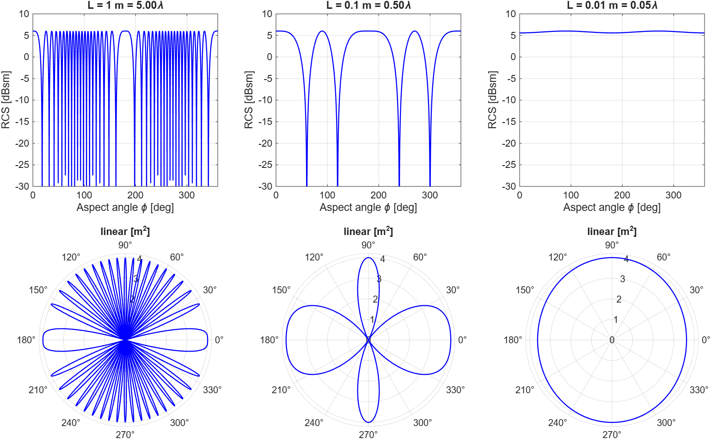

- **5.3–5.4 Multi-scatterer RCS.** Contributions add coherently with their two-way phase 2kr.
  Two 1 m² spheres follow 4σ₀cos²(kL cos φ) exactly, peaking at +6.02 dBsm. The number of lobes
  grows with the electrical separation: 40, 4 and 2 maxima for L = 5λ, λ/2 and λ/20. At λ/20
  the pair behaves as a single, almost isotropic 4 m² scatterer.

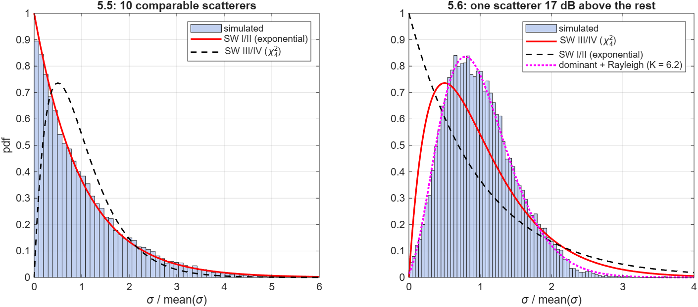

- **5.5 Comparable scatterers.** Ten scatterers of similar RCS, swept through 36 000 aspect
  angles, give an exponential pdf, the Swerling I/II model: std/mean = 0.93, KS distance 0.019.
- **5.6 One dominant scatterer.** Making one scatterer 17 dB stronger removes the deep fades,
  and the result moves towards Swerling III/IV (KS distance 0.115). **[2026]** The exact
  "dominant + Rayleigh" law fits much better (KS distance 0.010), so χ²₄ is only an
  approximation for a strong dominant scatterer.
- **[2026] Fluctuation loss.** A closed-form single-pulse Pd for Swerling III is derived and
  checked by Monte Carlo. For Pd = 0.9 at Pfa = 10⁻⁶, a constant target needs 13.2 dB,
  Swerling I/II needs 21.1 dB (8.0 dB more) and Swerling III/IV needs 17.3 dB (4.1 dB more).
  Monte Carlo runs that use the simulated RCS sequences of 5.5 and 5.6 land on those curves.

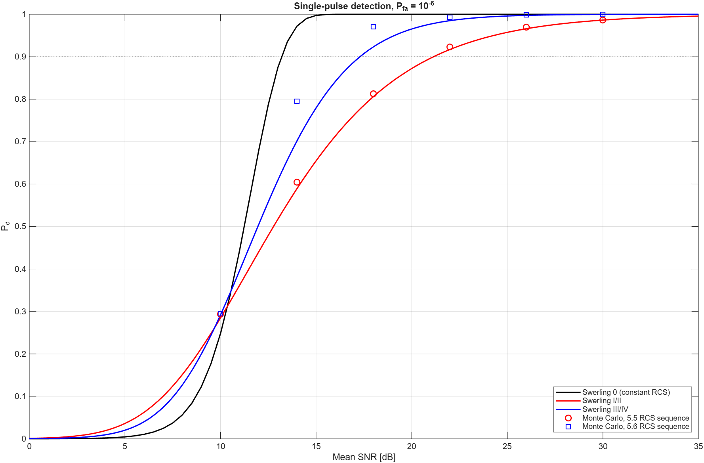

### CFAR detection (Lab 6)
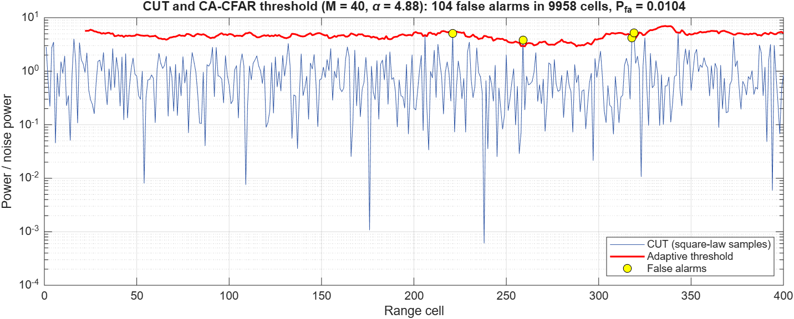

A cell-averaging CFAR estimates the noise from M training cells around the cell under test,
leaving G guard cells on each side, and scales that estimate by α. For square-law samples
(exponential, as verified in 6.1), the false-alarm probability is Pfa = (1 + α/M)^(−M), whatever
the noise power.
- **6.2.** For M = 40 and Pfa = 0.01, α = 4.8807. With known noise power it would be −ln Pfa =
  4.6052; the difference is the price of estimating the noise.
- **6.3.** With 1 guard cell per side, as in Fig. 3 of the statement, a 10 000-cell range
  profile gives 104 false alarms in 9958 valid cells: Pfa = 0.0104.
- **6.4.** With the lab's 10⁴ trials, Pfa = 10⁻³ rests on about 10 events and 10⁻⁴ on about 1,
  so those estimates are dominated by chance. **[2026]** With 2·10⁶ trials the measured values
  match the design within statistical error. The 10⁻⁴ point (171 counts against 200 expected)
  is 2σ low, about what one in four 95 % intervals should show.

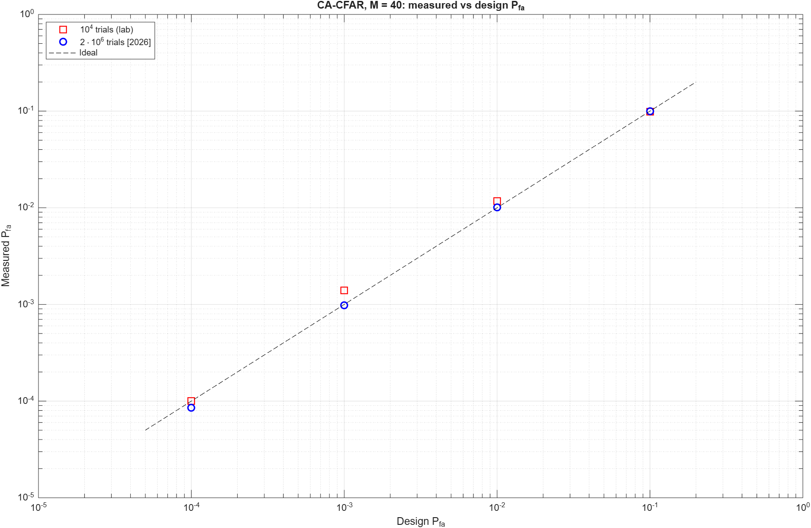 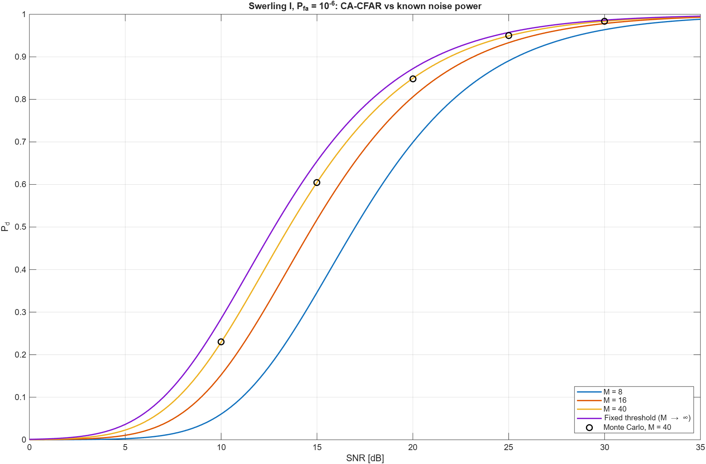

- **[2026] Pitfall: the detector law matters.** Using the square-law α on linear-detector
  (envelope) samples gives Pfa = 1.5·10⁻² instead of 10⁻¹, and not a single crossing in 2·10⁶
  trials instead of 10⁻².
- **[2026] CFAR loss.** For a Swerling I target at Pfa = 10⁻⁶ and Pd = 0.5, the loss is 4.2 dB
  with M = 8, 2.0 dB with M = 16 and 0.8 dB with M = 40. Monte Carlo agrees with the closed form
  within 0.002 in Pd.
- **[2026] Failure modes.** A 30 dB target masks a 13 dB neighbour six cells away, because it
  inflates the noise estimate 40-fold. At a +20 dB clutter edge, the local Pfa jumps to
  3.3·10⁻², 33 times the design value, just inside the clutter, and drops to zero just before
  it, where weak targets are masked. GO-CFAR and OS-CFAR are the standard remedies.

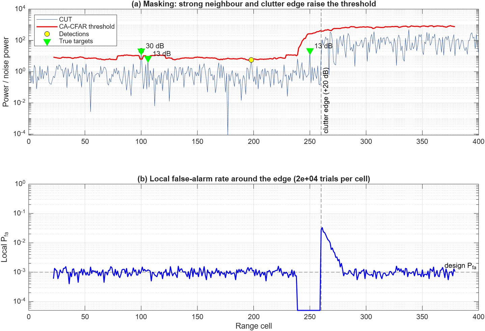

### MTI: delay-line cancellers (Lab 7)
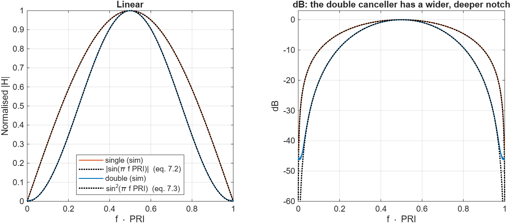

Stationary clutter returns the same phase on every pulse, so subtracting consecutive pulses
removes it. The single canceller, x[n] − x[n−1], and the double canceller, x[n] − 2x[n−1] +
x[n−2], are first- and second-order high-pass filters in slow time.
- **7.1–7.2.** White Gaussian noise (10 001 samples, 1 W) has a flat periodogram and a Gaussian
  histogram. After the single canceller the noise power doubles (2.08 W, against Σh² = 2) and
  the spectrum takes the shape 4 sin²(πf·PRI). The statement asks for the *double* canceller in
  7.2; from the title and 7.3 it is the single one, and that is what is simulated.
- **7.3–7.4.** Averaging 1000 runs, the normalised amplitude responses match |sin(πf·PRI)|
  (eq. 7.2) and sin²(πf·PRI) (eq. 7.3) to within 0.0069 and 0.0051.

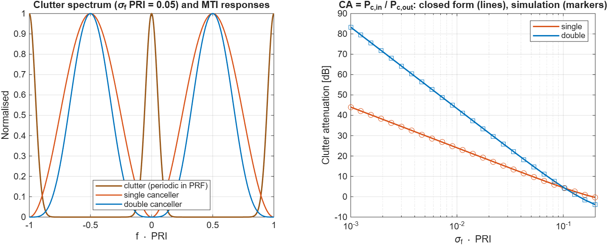

- **[2026] Clutter attenuation.** For a Gaussian clutter spectrum (eq. 7.1), the clutter
  attenuation has a closed form, CA = 1/Σᵢⱼ hᵢhⱼρ(i−j). Simulation agrees within 0.15 dB. Each
  decade of narrower clutter spectrum buys 20 dB with the single canceller and 40 dB with the
  double. At σ_f·PRI = 0.01: CA = 24.0 and 43.3 dB, improvement factor 27.1 and 51.1 dB.
- **[2026] Blind speeds.** For the demo radar (3 GHz, PRF 10 kHz) they fall every 500 m/s. The
  drone at 15 m/s is attenuated by 20.5 dB with the single canceller and by 41.1 dB with the
  double.

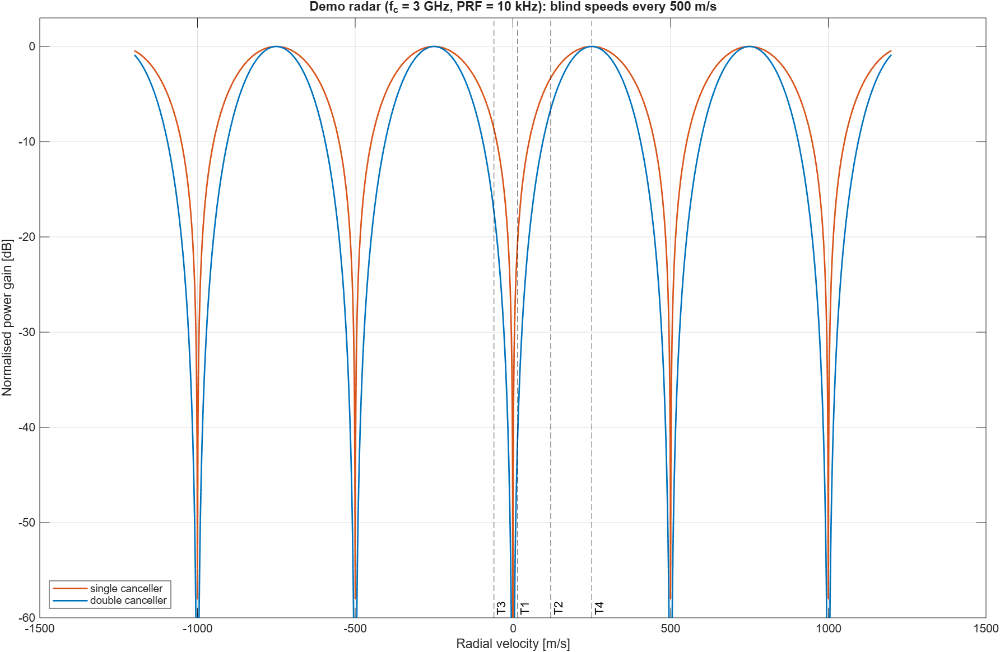

## Notes on the lab statements
Checking every result against theory turned up a few inconsistencies in the statements. They are
handled in the code and listed here so that the results can be compared with the handouts:
- **Lab 3.** The formula sheet gives 0.17 as the last coefficient of Albersheim's equation; 1.7
  is the value that reproduces the reference curves (Pd = 0.9, Pfa = 10⁻⁶ → 13.1 dB).
- **Lab 4.** The Doppler phase is written ω_d = 2·f₀·2v/c; the angular frequency is 2π·fd, with
  fd = 2v·f₀/c.
- **Lab 5.** The sphere routine in the handout returns |Σ| rather than |Σ|². The normalised RCS
  is |Σ|², which is what `rcs_sphere_mie` computes and what follows 9(ka)⁴ in the Rayleigh
  region. The text of 5.2 also names the plate routine `rcs_rect_plate`, while the code given is
  for a circular plate.
- **Lab 7.** Exercise 7.2 says "double canceller"; its title and exercise 7.3 refer to the single
  canceller, which is what is simulated.

## How to run
Requires MATLAB R2020a or newer, with no toolboxes (tested on R2026a).

```matlab
cd radar-pulsado
run scripts/demo_end_to_end.m        % or any of scripts/s01 … s07
results = runtests('tests');         % 49 tests
```
To regenerate every figure: `matlab -batch "addpath('scripts'); run_all"`. Each simulation
fixes its random seed, so every run gives the same numbers.

## Repository layout
```
src/waveform/     pulse_metrics, pulse_train, pulsed_radar, spectrum_fft, barker_code, phase_coded_pulse
src/link_budget/  cascade_noise_figure, radar_snr, max_detection_range [2026]
src/detection/    false_alarm_time, albersheim_snr, ca_cfar, ca_cfar_alpha, ca_cfar_pfa,
                  marcum_q, pd_swerling0, pd_swerling1, pd_swerling3, threshold_from_pfa, roc_empirical [2026]
src/rcs/          rcs_sphere_mie, rcs_circular_plate, rcs_scatterers, swerling_pdf
src/processing/   matched_filter, doppler_frequency, apply_doppler, sidelobe_metrics, barker_search,
                  mti_canceller, mti_response, mti_clutter_attenuation,
                  ambiguity_function [2026], detect_peaks [2026]
src/scene/        scene_default, simulate_scene, clutter_slow_time, roc_monte_carlo [2026]
src/util/         radar_constants, db2lin, lin2db, save_figure, repo_root
scripts/          s01_pulse_train · s02_radar_equation · s03_detection_theory · s04_pulse_compression ·
                  s05_rcs · s06_cfar · s07_mti · demo_end_to_end · run_all
tests/            matlab.unittest suites, one per src/ area
results/figures/  every figure in this README, regenerated by run_all
```

| Lab exercise | Where |
|---|---|
| 1.1 pulsed-radar function · 1.2–1.4 | `pulsed_radar`, `pulse_train`, `spectrum_fft` · `s01_pulse_train` |
| 2.1 noise figure · 2.2 radar equation · 2.3–2.6 | `cascade_noise_figure`, `radar_snr` · `s02_radar_equation` |
| 3.1 false-alarm time · 3.5 Albersheim · 3.2–3.6 | `false_alarm_time`, `albersheim_snr` · `s03_detection_theory` |
| 4.1 coded pulse · 4.2–4.7 | `phase_coded_pulse`, `matched_filter`, `barker_search` · `s04_pulse_compression` |
| 5.1 sphere · 5.2 plate · 5.3 multi-scatterer RCS · 5.4–5.6 two spheres, Swerling | `rcs_sphere_mie`, `rcs_circular_plate`, `rcs_scatterers`, `swerling_pdf` · `s05_rcs` |
| 6.1 detector statistics · 6.2 scaling factor · 6.3–6.4 CA-CFAR | `ca_cfar_alpha`, `ca_cfar`, `ca_cfar_pfa` · `s06_cfar` |
| 7.1 white noise · 7.2–7.4 single and double cancellers | `mti_canceller`, `mti_response` · `s07_mti` |

## Roadmap
- **Robust CFAR variants.** GO-CFAR for clutter edges and OS-CFAR for multiple targets.
- **Doppler processing.** A filter bank (MTD) and staggered PRFs, to keep slow targets and move
  the blind speeds.

## Authorship
Developed jointly and equally by **Adam Ruiz Herrero** and **Ali Yamani El Yamani**
(UPC-EETAC, *Radiolocalización*). This covers the lab sessions and the 2026 extensions.
The exploration sections of `s04` (signal anatomy, Barker-13 filter) come from study demos
written for Lab 4.

The lab statements belong to UPC-EETAC and are not part of this repository. Apart from
two RCS routines in the Lab 5 statement (adapted from Mahafza, 2005, and not redistributed),
the course provides no code: the statements only specify inputs and outputs. Details are in
[CREDITS.md](CREDITS.md). Licensed under the [MIT License](LICENSE).
